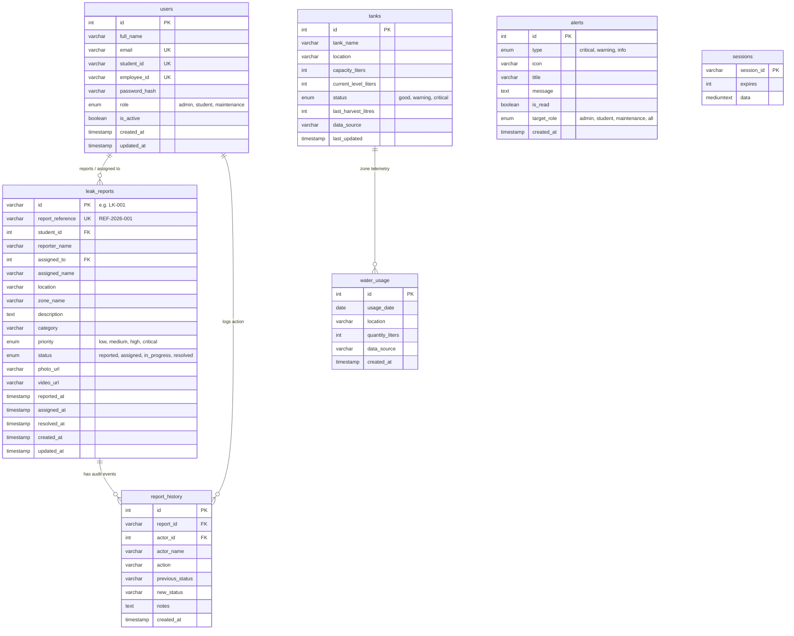

# AquaManage — Local MySQL Database Design Specification

**Database Name:** `aqua_manage_local`  
**Storage Engine:** InnoDB  
**Character Set:** `utf8mb4`  
**Collation:** `utf8mb4_unicode_ci`  
**Script Location:** `backend/database/schema.sql`  
**Seed Runner:** `backend/database/seed.js`  
**Verification Script:** `backend/database/verify.sql`  

---

## 1. Entity-Relationship Overview



---

## 2. Table Definitions & Schemas

### 2.1 `users` Table
Stores authenticated campus accounts across the three portals. Passwords are encrypted with bcrypt (10 salt rounds).

```sql
CREATE TABLE IF NOT EXISTS `users` (
  `id` INT AUTO_INCREMENT PRIMARY KEY,
  `full_name` VARCHAR(100) NOT NULL,
  `email` VARCHAR(100) UNIQUE NULL,
  `student_id` VARCHAR(50) UNIQUE NULL,
  `employee_id` VARCHAR(50) UNIQUE NULL,
  `password_hash` VARCHAR(255) NOT NULL,
  `role` ENUM('admin', 'student', 'maintenance') NOT NULL,
  `is_active` BOOLEAN NOT NULL DEFAULT TRUE,
  `created_at` TIMESTAMP NOT NULL DEFAULT CURRENT_TIMESTAMP,
  `updated_at` TIMESTAMP NOT NULL DEFAULT CURRENT_TIMESTAMP ON UPDATE CURRENT_TIMESTAMP,
  INDEX `idx_users_role` (`role`),
  INDEX `idx_users_email` (`email`),
  INDEX `idx_users_student` (`student_id`),
  INDEX `idx_users_employee` (`employee_id`)
) ENGINE=InnoDB DEFAULT CHARSET=utf8mb4 COLLATE=utf8mb4_unicode_ci;
```

### 2.2 `leak_reports` Table
Stores all submitted water complaints with priority, location, status, and assignment.

```sql
CREATE TABLE IF NOT EXISTS `leak_reports` (
  `id` VARCHAR(20) PRIMARY KEY,
  `report_reference` VARCHAR(50) UNIQUE NOT NULL,
  `student_id` INT NULL,
  `reporter_name` VARCHAR(100) NOT NULL,
  `assigned_to` INT NULL,
  `assigned_name` VARCHAR(100) NULL,
  `location` VARCHAR(255) NOT NULL,
  `zone_name` VARCHAR(100) NOT NULL,
  `description` TEXT NOT NULL,
  `category` VARCHAR(50) NOT NULL,
  `priority` ENUM('low', 'medium', 'high', 'critical') NOT NULL DEFAULT 'medium',
  `status` ENUM('reported', 'assigned', 'in_progress', 'resolved') NOT NULL DEFAULT 'reported',
  `photo_url` VARCHAR(255) NULL,
  `video_url` VARCHAR(255) NULL,
  `reported_at` TIMESTAMP NOT NULL DEFAULT CURRENT_TIMESTAMP,
  `assigned_at` TIMESTAMP NULL DEFAULT NULL,
  `resolved_at` TIMESTAMP NULL DEFAULT NULL,
  `created_at` TIMESTAMP NOT NULL DEFAULT CURRENT_TIMESTAMP,
  `updated_at` TIMESTAMP NOT NULL DEFAULT CURRENT_TIMESTAMP ON UPDATE CURRENT_TIMESTAMP,
  CONSTRAINT `fk_leak_reports_student` FOREIGN KEY (`student_id`) REFERENCES `users` (`id`) ON DELETE SET NULL,
  CONSTRAINT `fk_leak_reports_assigned` FOREIGN KEY (`assigned_to`) REFERENCES `users` (`id`) ON DELETE SET NULL
) ENGINE=InnoDB DEFAULT CHARSET=utf8mb4 COLLATE=utf8mb4_unicode_ci;
```

### 2.3 `report_history` Table
Auditable append-only log capturing the complaint lifecycle (`reported` &rarr; `assigned` &rarr; `in_progress` &rarr; `resolved`).

```sql
CREATE TABLE IF NOT EXISTS `report_history` (
  `id` INT AUTO_INCREMENT PRIMARY KEY,
  `report_id` VARCHAR(20) NOT NULL,
  `actor_id` INT NULL,
  `actor_name` VARCHAR(100) NOT NULL,
  `action` VARCHAR(50) NOT NULL,
  `previous_status` VARCHAR(50) NULL,
  `new_status` VARCHAR(50) NULL,
  `notes` TEXT NULL,
  `created_at` TIMESTAMP NOT NULL DEFAULT CURRENT_TIMESTAMP,
  CONSTRAINT `fk_report_history_report` FOREIGN KEY (`report_id`) REFERENCES `leak_reports` (`id`) ON DELETE CASCADE,
  CONSTRAINT `fk_report_history_actor` FOREIGN KEY (`actor_id`) REFERENCES `users` (`id`) ON DELETE SET NULL
) ENGINE=InnoDB DEFAULT CHARSET=utf8mb4 COLLATE=utf8mb4_unicode_ci;
```

### 2.4 `tanks` Table
Stores water tank capacities and level readings. Seeded records are explicitly tagged with `data_source = 'Demonstration Record'`.

```sql
CREATE TABLE IF NOT EXISTS `tanks` (
  `id` INT AUTO_INCREMENT PRIMARY KEY,
  `tank_name` VARCHAR(100) NOT NULL,
  `location` VARCHAR(100) NOT NULL,
  `capacity_liters` INT NOT NULL,
  `current_level_liters` INT NOT NULL DEFAULT 0,
  `status` ENUM('good', 'warning', 'critical') NOT NULL DEFAULT 'good',
  `last_harvest_litres` INT NOT NULL DEFAULT 0,
  `last_updated` TIMESTAMP NOT NULL DEFAULT CURRENT_TIMESTAMP ON UPDATE CURRENT_TIMESTAMP,
  `data_source` VARCHAR(50) NOT NULL DEFAULT 'Demonstration Record'
) ENGINE=InnoDB DEFAULT CHARSET=utf8mb4 COLLATE=utf8mb4_unicode_ci;
```

### 2.5 `water_usage` Table
Stores historical daily consumption for the campus zones (Academic Block, PPCRC, Mithila Hostel, Vikramshila Hostel, Canteen).

```sql
CREATE TABLE IF NOT EXISTS `water_usage` (
  `id` INT AUTO_INCREMENT PRIMARY KEY,
  `usage_date` DATE NOT NULL,
  `location` VARCHAR(100) NOT NULL,
  `quantity_liters` INT NOT NULL,
  `data_source` VARCHAR(50) NOT NULL DEFAULT 'Demonstration Record',
  `created_at` TIMESTAMP NOT NULL DEFAULT CURRENT_TIMESTAMP
) ENGINE=InnoDB DEFAULT CHARSET=utf8mb4 COLLATE=utf8mb4_unicode_ci;
```

### 2.6 `alerts` Table
Stores alerts shown in the Topbar bell notification dropdown and Admin Alerts page.

```sql
CREATE TABLE IF NOT EXISTS `alerts` (
  `id` INT AUTO_INCREMENT PRIMARY KEY,
  `type` ENUM('critical', 'warning', 'info') NOT NULL DEFAULT 'info',
  `icon` VARCHAR(50) NOT NULL DEFAULT 'AlertTriangle',
  `title` VARCHAR(150) NOT NULL,
  `message` TEXT NOT NULL,
  `is_read` BOOLEAN NOT NULL DEFAULT FALSE,
  `target_role` ENUM('admin', 'student', 'maintenance', 'all') NOT NULL DEFAULT 'all',
  `created_at` TIMESTAMP NOT NULL DEFAULT CURRENT_TIMESTAMP
) ENGINE=InnoDB DEFAULT CHARSET=utf8mb4 COLLATE=utf8mb4_unicode_ci;
```

---

## 3. Seeded Demonstration Dataset

| Table | Count | Highlights |
| :--- | :--- | :--- |
| `users` | 8 | 2 Admins, 3 Maintenance Staff, 3 Students |
| `tanks` | 4 | Tank A (50kL), Tank B (30kL), Tank C (20kL), Tank D (15kL) |
| `leak_reports`| 8 | Mix of categories (`Pipe Leak`, `Pipe Burst`, `Tap Wastage`, `Overflow`) across all campus zones |
| `report_history` | 13 | Audited event logs demonstrating state progression |
| `water_usage` | 70 | 14 days &times; 5 campus zones with realistic day-to-day variances |
| `alerts` | 6 | Live warnings, critical level notices, and resolution updates |
