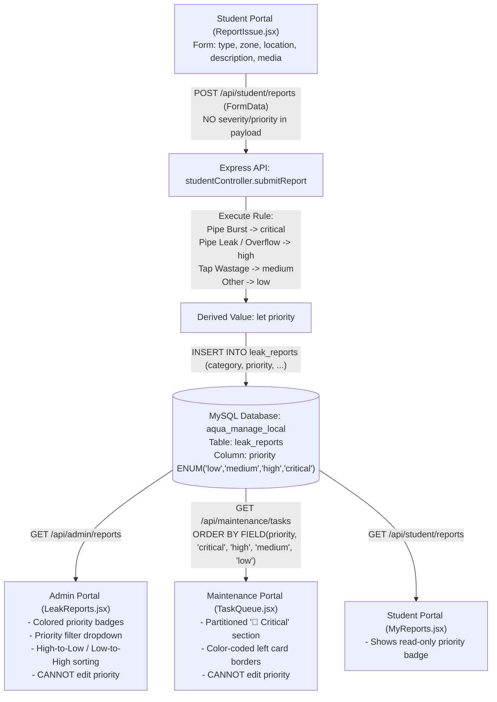

# AquaManage — Report Severity & Priority: Comprehensive Read-Only Audit

**Project:** College DTI (Design Thinking & Innovation) — Smart Campus Water Management  
**Audit Type:** Strict Read-Only Technical Architecture & Implementation Audit  
**Date of Audit:** November 12, 2026  
**Audited Branch:** `feature/local-fullstack-dti`  
**Database:** Local MySQL Community Server (`aqua_manage_local`)  

---

## 1. Executive Conclusion

### Core Question
> **When a student submits a water leakage or other maintenance report, how does the application decide whether its severity is Critical, High, Medium, or Low?**

### Definitive Finding
**The severity/priority is automatically calculated by the backend Express REST API.**

Neither the student nor an administrator selects or modifies the report severity. Instead:
1. The student selects an **Issue Type** from a dropdown list (`Pipe Leak`, `Tap Wastage`, `Pipe Burst`, `Overflow`, `Sprinkler Fault`, `Blocked Drain`, `Other`).
2. The frontend transmits only this categorical issue `type` string.
3. The backend Express API controller ([studentController.js](file:///Users/mrugmaythere/work/DTIL/AquaManage/backend/src/controllers/studentController.js#L59-L65)) executes a hardcoded rule mapping the issue `type` to the `priority` column:
   * **`Pipe Burst`** $\rightarrow$ **`critical`**
   * **`Pipe Leak`** or **`Overflow`** $\rightarrow$ **`high`**
   * **`Tap Wastage`** $\rightarrow$ **`medium`**
   * **All other categories** (`Sprinkler Fault`, `Blocked Drain`, `Other`, or unknown) $\rightarrow$ **`low`**

> [!IMPORTANT]  
> If a client sends a custom `priority` or `severity` property in the HTTP request payload, the backend ignores it entirely. Priority assignment is completely deterministic and coupled strictly to the issue category name.

---

## 2. Severity Data Flow & System Lifecycle



### Stage-by-Stage Breakdown

### A. Frontend — Report Submission
* **Component:** [ReportIssue.jsx](file:///Users/mrugmaythere/work/DTIL/AquaManage/src/pages/student/ReportIssue.jsx#L14)
* **Form State:**
  ```javascript
  const [form, setForm] = useState({ 
    type: '', 
    zone: '', 
    location: '', 
    description: '', 
    photo: null, 
    video: null 
  });
  ```
* **Behavior:**
  * No severity or priority UI element (dropdown, radio, or checkbox) exists on the form.
  * Validation checks strictly require `type`, `zone`, and `description >= 10` characters ([ReportIssue.jsx#L53-L61](file:///Users/mrugmaythere/work/DTIL/AquaManage/src/pages/student/ReportIssue.jsx#L53-L61)).

### B. Client Service Layer & Outgoing API Request
* **Service File:** [studentService.js](file:///Users/mrugmaythere/work/DTIL/AquaManage/src/services/studentService.js#L24-L38)
* **Outgoing Payload:**
  ```javascript
  const formData = new FormData();
  formData.append('type', type);
  formData.append('zone', zone);
  formData.append('location', location || `${zone} — Campus Area`);
  formData.append('description', description.trim());
  formData.append('reporterName', user?.name || 'Student');
  formData.append('reporterId', user?.id || '');
  if (photoFile) formData.append('photo', photoFile);
  if (videoFile) formData.append('video', videoFile);
  ```
* **Payload Structure:** Transmitted as `multipart/form-data` to `POST /api/student/reports`. Contains zero priority or severity parameters.

### C. Backend API Processing
* **Controller:** [studentController.js](file:///Users/mrugmaythere/work/DTIL/AquaManage/backend/src/controllers/studentController.js#L59-L65)
* **Calculation Algorithm:**
  ```javascript
  // Auto-assign priority based on severity
  let priority = 'medium';
  if (type === 'Pipe Burst') priority = 'critical';
  else if (type === 'Pipe Leak' || type === 'Overflow') priority = 'high';
  else if (type === 'Tap Wastage') priority = 'medium';
  else priority = 'low';
  ```
* **Side-Effect Telemetry:** If `priority === 'critical'`, the backend automatically inserts a `critical` alert with an `'AlertTriangle'` icon into the `alerts` table; otherwise it logs a `warning` alert with a `'Droplets'` icon ([studentController.js#L108-L117](file:///Users/mrugmaythere/work/DTIL/AquaManage/backend/src/controllers/studentController.js#L108-L117)).

### D. Database Storage
* **Table:** `leak_reports`
* **Column:** `priority`
* **Data Definition:**
  ```sql
  `priority` ENUM('low', 'medium', 'high', 'critical') NOT NULL DEFAULT 'medium'
  ```
* **Field Verification:**
  * No separate `severity` column exists; the database field is named `priority`.
  * The column has an index `idx_leak_reports_priority`.
  * The column disallows `NULL` values and defaults to `'medium'`.
* **Current Database Distribution (16 total records):**
  * `high`: 8 records (50.0%)
  * `medium`: 4 records (25.0%)
  * `low`: 3 records (18.75%)
  * `critical`: 1 record (6.25%)
  * Invalid/NULL records: 0

### E. Administrator Oversight
* **Controller:** [adminController.js](file:///Users/mrugmaythere/work/DTIL/AquaManage/backend/src/controllers/adminController.js)
* **Frontend View:** [LeakReports.jsx](file:///Users/mrugmaythere/work/DTIL/AquaManage/src/pages/admin/LeakReports.jsx)
* **Behavior:**
  * Administrators view priority as a colored badge (`<span className="badge {priority}">{priority}</span>`).
  * Administrators can filter reports by priority and sort columns.
  * **No editing functionality:** Routes `PATCH /reports/:id/assign` and `PATCH /reports/:id/status` do not accept or modify priority. There is no endpoint in the system allowing administrators to adjust priority.

### F. Maintenance Task Queue & Dispatch
* **Controller:** [maintenanceController.js](file:///Users/mrugmaythere/work/DTIL/AquaManage/backend/src/controllers/maintenanceController.js#L25)
* **Frontend View:** [TaskQueue.jsx](file:///Users/mrugmaythere/work/DTIL/AquaManage/src/pages/maintenance/TaskQueue.jsx#L187-L250)
* **Behavior:**
  * Tasks are ordered by SQL priority weighting:
    ```sql
    ORDER BY FIELD(r.priority, 'critical', 'high', 'medium', 'low'), r.created_at ASC
    ```
  * `TaskQueue.jsx` splits tasks into two visual containers:
    1. **🚨 Critical — Immediate Action Required:** Displayed prominently with red alert banners.
    2. **Standard Tasks:** Displayed below critical tasks.
  * Individual cards feature a 4px priority-colored left border (Red for Critical, Amber for High, Teal for Medium, Navy for Low).
  * Technicians can change report status (`in_progress`, `resolved`) and add work logs, but cannot edit priority.

---

## 3. Current Severity / Priority Definitions

| Level | Accepted by System? | How Assigned? | Can It Be Changed? | Where Displayed? |
| :--- | :--- | :--- | :--- | :--- |
| **`critical`** | Yes (Valid ENUM) | Automatically mapped when issue `type === 'Pipe Burst'` | No (Permanent) | Admin Reports, Campus Map (pulsing red icon), Maintenance Task Queue (top alert section), Student My Reports, Topbar Search |
| **`high`** | Yes (Valid ENUM) | Automatically mapped when issue `type === 'Pipe Leak'` or `'Overflow'` | No (Permanent) | Admin Reports, Campus Map (amber icon), Maintenance Task Queue (standard section, amber left border), Student My Reports |
| **`medium`** | Yes (Valid ENUM) | Automatically mapped when issue `type === 'Tap Wastage'` (also SQL `DEFAULT`) | No (Permanent) | Admin Reports, Campus Map (blue icon), Maintenance Task Queue (teal left border), Student My Reports |
| **`low`** | Yes (Valid ENUM) | Automatically mapped for all other types (`Sprinkler Fault`, `Blocked Drain`, `Other`, unknown) | No (Permanent) | Admin Reports, Campus Map (slate icon), Maintenance Task Queue (navy left border), Student My Reports |

---

## 4. Source Code Evidence Index

| Entity / Concept | File | Lines | Summary of Evidence |
| :--- | :--- | :--- | :--- |
| **Student UI Form** | [ReportIssue.jsx](file:///Users/mrugmaythere/work/DTIL/AquaManage/src/pages/student/ReportIssue.jsx#L14) | L14, L53–L61, L178–L191 | Form state and validation exclude any priority/severity input. |
| **Client Service** | [studentService.js](file:///Users/mrugmaythere/work/DTIL/AquaManage/src/services/studentService.js#L24-L38) | L24–L38 | FormData builder transmits only category, zone, location, description, and media. |
| **Backend Decision Logic** | [studentController.js](file:///Users/mrugmaythere/work/DTIL/AquaManage/backend/src/controllers/studentController.js#L59-L65) | L59–L65 | Hardcoded if/else mapping assigns priority based on type string. |
| **System Alert Creation** | [studentController.js](file:///Users/mrugmaythere/work/DTIL/AquaManage/backend/src/controllers/studentController.js#L108-L117) | L108–L117 | Evaluates `priority === 'critical'` to trigger high-priority alerts. |
| **Database Schema** | [schema.sql](file:///Users/mrugmaythere/work/DTIL/AquaManage/backend/database/schema.sql#L44-L45) | L44–L45 | `priority ENUM('low','medium','high','critical') NOT NULL DEFAULT 'medium'`. |
| **Maintenance Sorting** | [maintenanceController.js](file:///Users/mrugmaythere/work/DTIL/AquaManage/backend/src/controllers/maintenanceController.js#L25) | L25 | Explicit SQL `FIELD()` ordering by priority weight. |
| **Maintenance UI Partition** | [TaskQueue.jsx](file:///Users/mrugmaythere/work/DTIL/AquaManage/src/pages/maintenance/TaskQueue.jsx#L187-L235) | L187–L235 | Dedicated visual section for critical tasks. |
| **Admin Reports Table** | [LeakReports.jsx](file:///Users/mrugmaythere/work/DTIL/AquaManage/src/pages/admin/LeakReports.jsx#L20) | L20, L136–L145, L411 | Sorting dictionary `PRIORITY_ORDER`, filter dropdown, read-only badge. |
| **GIS Map Pins** | [CampusMap.jsx](file:///Users/mrugmaythere/work/DTIL/AquaManage/src/components/CampusMap.jsx#L83-L90) | L83–L90 | `leakIcon(priority)` assigns distinct pin colors per priority. |
| **CSS Badges** | [index.css](file:///Users/mrugmaythere/work/DTIL/AquaManage/src/index.css#L491-L494) | L491–L494 | Color tokens for `.badge.critical`, `.badge.high`, `.badge.medium`, `.badge.low`. |

---

## 5. Architectural Gaps & Discrepancies

1. **Nomenclature Divergence:**
   * Documentation and UI text frequently use the term *"Severity"*, whereas internal models, routes, and database tables use *"Priority"*. Defensive fallback code in [HeroBanner.jsx](file:///Users/mrugmaythere/work/DTIL/AquaManage/src/components/HeroBanner.jsx#L360) (`t.priority || t.severity`) confirms previous confusion around naming.
2. **Context-Insensitive Classification:**
   * A "Blocked Drain" causing severe flooding in a server room or research laboratory is assigned `'low'` priority by default, because category name is the sole determinant.
3. **No Administrative Reclassification:**
   * Facility managers cannot escalate or downgrade priority after physical verification.
4. **Seed Data Inconsistency:**
   * In [seed.js](file:///Users/mrugmaythere/work/DTIL/AquaManage/backend/database/seed.js#L214-L249), seed reports `LK-002` and `LK-003` have `category: 'Pipe Leak'` with `priority: 'medium'`. However, any runtime report submitted with `type: 'Pipe Leak'` is assigned `priority: 'high'`.
5. **Absence of Test Assertions:**
   * The automated backend test suite ([run-tests.js](file:///Users/mrugmaythere/work/DTIL/AquaManage/backend/tests/run-tests.js)) contains 84 tests, but **0 assertions** validating priority assignment, missing priority fallbacks, or priority ordering.

---

## 6. Practical Recommended Improvements

*(Tailored for academic DTI demonstration without overengineering or unnecessary AI models)*

1. **Add Admin Priority Elevation:**
   * Introduce a `PATCH /api/admin/reports/:id/priority` endpoint with validation (`low`, `medium`, `high`, `critical`).
   * Record changes in `report_history` with administrator notes.
2. **Add Student Urgency Checkbox:**
   * In [ReportIssue.jsx](file:///Users/mrugmaythere/work/DTIL/AquaManage/src/pages/student/ReportIssue.jsx), add an optional checkbox: *"Active flooding or safety hazard present?"*.
   * If checked, promote any standard issue to `'high'` or `'critical'`.
3. **Standardize Naming:**
   * Align all frontend documentation, component properties, and badges to "Priority" (or "Severity") uniformly.
4. **Add Automated Priority Tests:**
   * Add test cases in `run-tests.js` verifying that `POST /api/student/reports` produces the expected priority for each category.

---

## 7. Verification Record

* **Files Inspected:** 26 application and test files.
* **Database State:** 16 existing records verified via read-only SQL queries; zero schema modifications made.
* **Test Verification:** Full backend test suite executed (84 passing tests); confirmed zero priority-specific assertions exist.
* **Modifications Made:** **None.** (Zero code edits, zero schema changes, zero database writes).
